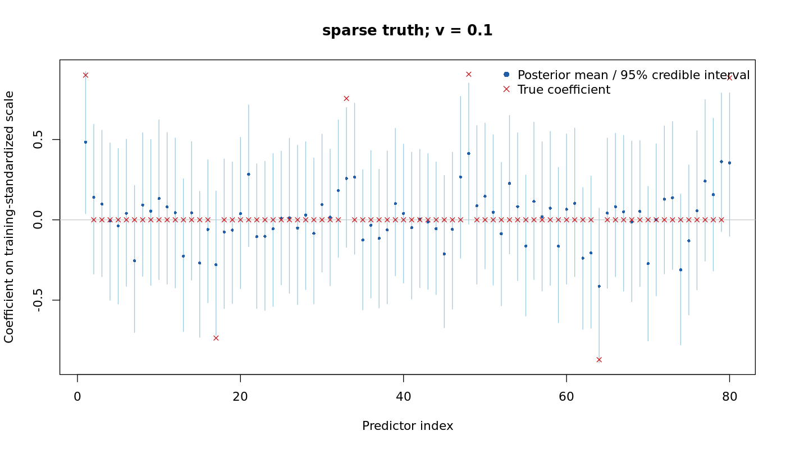
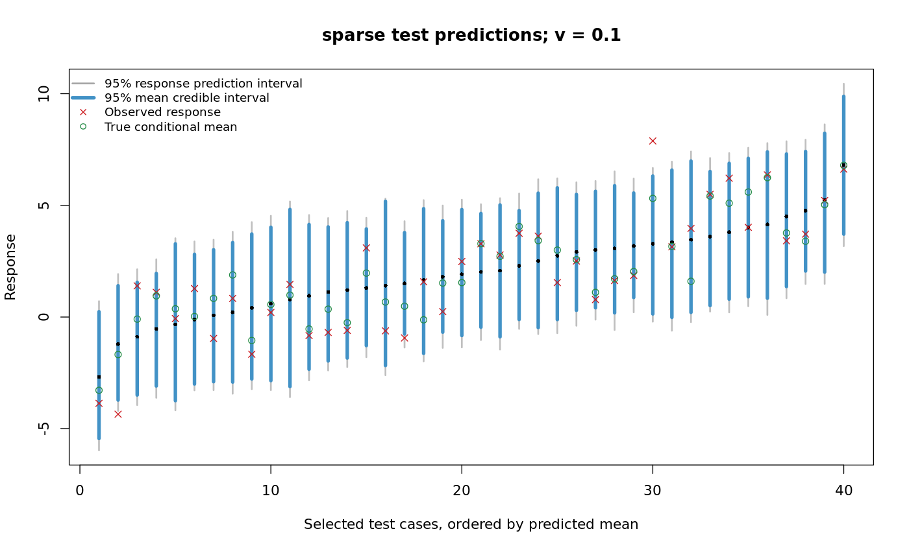

```{r}
ridge_gibbs <- function(X, y, v, n_iter = 3000L, burn = 1000L,
                        a0 = 2, b0 = 1, initial_s2 = 1, seed = NULL) {
  X <- as.matrix(X)
  y <- as.numeric(y)
  validate_gibbs_inputs(X, y, v, n_iter, burn, a0, b0, initial_s2)
  if (!is.null(seed)) set.seed(seed)
  n <- nrow(X)
  p <- ncol(X)
  Z <- cbind("(Intercept)" = 1, X)
  q <- ncol(Z)
  G <- crossprod(Z)
  h <- drop(crossprod(Z, y))

  P <- diag(c(0, rep(1 / v, p)))
  require_completed(P, "prior precision")
  stopifnot(is.matrix(P), all(dim(P) == c(q, q)))

  theta <- c(mean(y), rep(0, p))
  s2 <- initial_s2
  theta_trace <- matrix(NA_real_, n_iter + 1L, q)
  sigma2_trace <- numeric(n_iter + 1L)
  theta_trace[1, ] <- theta
  sigma2_trace[1] <- s2
  colnames(theta_trace) <- colnames(Z)
  for (iteration in seq_len(n_iter)) {
    A <- G / s2 + P
    h_cond <- h / s2
    require_completed(A, "conditional precision")
    require_completed(h_cond, "conditional mean numerator")
    stopifnot(is.matrix(A), all(dim(A) == c(q, q)), length(h_cond) == q)
    theta <- draw_from_precision(A, h_cond)
    rss <- sum((y - drop(Z %*% theta))^2)
    shape <- a0 + n / 2
    rate <- b0 + rss / 2
    require_completed(shape, "variance shape")
    require_completed(rate, "variance rate")
    stopifnot(length(shape) == 1L, shape > 0, length(rate) == 1L, rate > 0)
    s2 <- 1 / rgamma(1, shape = shape, rate = rate)
    theta_trace[iteration + 1L, ] <- theta
    sigma2_trace[iteration + 1L] <- s2
  }
  retained <- seq.int(burn + 2L, n_iter + 1L)
  list(theta = theta_trace[retained, , drop = FALSE],
       sigma2 = sigma2_trace[retained], theta_trace = theta_trace,
       sigma2_trace = sigma2_trace,
       settings = list(v = v, a0 = a0, b0 = b0, n_iter = n_iter,
                       burn = burn, thinning = 1L, initial_s2 = initial_s2,
                       seed = seed))
}
```

```{r}
simulate_lab_data <- function(n_train = 50L, n_test = 300L, p = 80L,
                              rho = 0.7, signal_variance = 4,
                              sigma = 1, intercept = 2, seed = 704L) {
  stopifnot(n_train >= 3, n_test >= 1, p >= 6, abs(rho) < 1,
            signal_variance > 0, sigma > 0)
  set.seed(seed)
  Sigma <- rho^abs(outer(seq_len(p), seq_len(p), "-"))
  X <- matrix(rnorm((n_train + n_test) * p), ncol = p) %*% chol(Sigma)
  colnames(X) <- paste0("x", seq_len(p))
  sparse <- numeric(p)
  active <- as.integer(round(seq(1, p, length.out = 6)))
  sparse[active] <- c(1, -1, 1, 1, -1, 1)
  dense <- rnorm(p)
  match_energy <- function(b) {
    b * sqrt(signal_variance / drop(crossprod(b, Sigma %*% b)))
  }
  beta <- list(sparse = match_energy(sparse), dense = match_energy(dense))
  # The paired scenarios share their predictors AND their noise realization.
  noise <- rnorm(nrow(X), sd = sigma)
  mu <- lapply(beta, function(b) intercept + drop(X %*% b))
  y <- lapply(mu, function(m) m + noise)
  train <- seq_len(n_train)
  test <- seq.int(n_train + 1L, nrow(X))
  list(X_train = X[train, , drop = FALSE],
       X_test = X[test, , drop = FALSE],
       y_train = lapply(y, function(z) z[train]),
       y_test = lapply(y, function(z) z[test]),
       mu_test = lapply(mu, function(z) z[test]), beta = beta,
       Sigma = Sigma, noise_train = noise[train], noise_test = noise[test],
       intercept = intercept, sigma = sigma,
       signal_variance = signal_variance, seed = seed)
}

standardize_training <- function(X) {
  X <- as.matrix(X)
  stopifnot(is.numeric(X), nrow(X) >= 2, ncol(X) >= 1,
            all(is.finite(X)))
  center <- colMeans(X)
  scale <- apply(X, 2, sd)
  if (any(!is.finite(scale) | scale <= 0)) {
    stop("Remove constant training predictors before running this lab.")
  }
  list(X = sweep(sweep(X, 2, center, "-"), 2, scale, "/"),
       center = center, scale = scale)
}

standardize_new <- function(X, preparation) {
  X <- as.matrix(X)
  stopifnot(is.numeric(X), ncol(X) == length(preparation$center),
            all(is.finite(X)))
  sweep(sweep(X, 2, preparation$center, "-"),
        2, preparation$scale, "/")
}

validate_gibbs_inputs <- function(X, y, v, n_iter, burn, a0, b0, initial_s2) {
  stopifnot(is.matrix(X), is.numeric(X), nrow(X) >= 2, ncol(X) >= 1,
            length(y) == nrow(X), all(is.finite(X)), all(is.finite(y)))
  positive_scalar <- function(z) {
    is.numeric(z) && length(z) == 1L && is.finite(z) && z > 0
  }
  stopifnot(positive_scalar(v), positive_scalar(a0), positive_scalar(b0),
            positive_scalar(initial_s2),
            length(n_iter) == 1L, is.finite(n_iter),
            n_iter == as.integer(n_iter),
            length(burn) == 1L, is.finite(burn), burn == as.integer(burn),
            burn >= 0, n_iter > burn)
  invisible(TRUE)
}

require_completed <- function(value, expression_name) {
  if (anyNA(value) || any(!is.finite(value))) {
    stop(paste0("The ", expression_name,
                " expression is not completed. Replace its NA_real_ placeholder."),
         call. = FALSE)
  }
  invisible(TRUE)
}

draw_from_precision <- function(A, h) {
  # For an upper triangular R, chol(A) returns R with t(R) %*% R = A.
  # Triangular solves give the mean and a normal draw without a matrix inverse.
  R <- chol(A)
  posterior_mean <- backsolve(R, forwardsolve(t(R), h))
  drop(posterior_mean + backsolve(R, rnorm(length(h))))
}

posterior_predictions <- function(fit, X_new, level = 0.95, seed = NULL) {
  X_new <- as.matrix(X_new)
  stopifnot(is.numeric(X_new), nrow(X_new) > 0,
            ncol(X_new) + 1L == ncol(fit$theta),
            all(is.finite(X_new)), level > 0, level < 1,
            length(fit$sigma2) == nrow(fit$theta),
            all(is.finite(fit$sigma2)), all(fit$sigma2 > 0))
  if (!is.null(seed)) set.seed(seed)
  Z_new <- cbind(1, X_new)
  mean_draws <- fit$theta %*% t(Z_new)
  errors <- matrix(rnorm(length(mean_draws)), nrow = nrow(mean_draws))
  response_draws <- mean_draws + sweep(errors, 1, sqrt(fit$sigma2), "*")
  tail_probability <- (1 - level) / 2
  probabilities <- c(tail_probability, 1 - tail_probability)
  mean_bounds <- apply(mean_draws, 2, quantile,
                       probs = probabilities, names = FALSE)
  response_bounds <- apply(response_draws, 2, quantile,
                           probs = probabilities, names = FALSE)
  data.frame(mean = colMeans(mean_draws),
             mean_lower = mean_bounds[1, ], mean_upper = mean_bounds[2, ],
             prediction_lower = response_bounds[1, ],
             prediction_upper = response_bounds[2, ])
}

original_scale_draws <- function(fit, preparation) {
  beta <- sweep(fit$theta[, -1, drop = FALSE], 2, preparation$scale, "/")
  intercept <- fit$theta[, 1] - drop(beta %*% preparation$center)
  cbind("(Intercept)" = intercept, beta)
}

batch_mcse <- function(z, batch_size = 50L) {
  n_batches <- length(z) %/% batch_size
  if (n_batches < 2L) return(NA_real_)
  means <- colMeans(matrix(z[seq_len(n_batches * batch_size)],
                           nrow = batch_size))
  sqrt(var(means) / n_batches)
}

chain_diagnostics <- function(first, second, scenario, slope_index) {
  fits <- list(first = first, second = second)
  out <- list()
  for (chain in names(fits)) {
    fit <- fits[[chain]]
    quantities <- list(sigma2 = fit$sigma2,
                       slope = fit$theta[, slope_index + 1L])
    for (quantity in names(quantities)) {
      z <- quantities[[quantity]]
      out[[length(out) + 1L]] <- data.frame(
        scenario = scenario, chain = chain, quantity = quantity,
        slope_index = if (quantity == "slope") slope_index else NA_integer_,
        mean = mean(z), sd = sd(z), mcse_batch = batch_mcse(z),
        lag1_acf = if (sd(z) > 0) as.numeric(acf(z, lag.max = 1,
                                      plot = FALSE)$acf[2]) else NA_real_)
    }
  }
  do.call(rbind, out)
}

fit_metrics <- function(fit, prediction, X_train, y_train, y_test,
                        beta_truth, scenario, v) {
  mean_theta <- colMeans(fit$theta)
  beta_mean <- mean_theta[-1]
  training_mean <- drop(cbind(1, X_train) %*% mean_theta)
  data.frame(scenario = scenario, method = "Bayesian ridge", v = v,
             status = "available",
             beta_rmse_standardized = sqrt(mean((beta_mean - beta_truth)^2)),
             slope_norm = sqrt(sum(beta_mean^2)),
             training_rmse = sqrt(mean((y_train - training_mean)^2)),
             test_rmse = sqrt(mean((y_test - prediction$mean)^2)),
             prediction_coverage = mean(y_test >= prediction$prediction_lower &
                                          y_test <= prediction$prediction_upper),
             prediction_width = mean(prediction$prediction_upper -
                                       prediction$prediction_lower),
             mean_ci_response_containment = mean(y_test >= prediction$mean_lower &
                                                   y_test <= prediction$mean_upper),
             sigma2_mean = mean(fit$sigma2))
}

baseline_metrics <- function(X_train, X_test, y_train, y_test,
                             beta_truth, scenario) {
  empty_row <- function(method, status) {
    data.frame(scenario = scenario, method = method, v = NA_real_, status = status,
      beta_rmse_standardized = NA_real_, slope_norm = NA_real_,
      training_rmse = NA_real_, test_rmse = NA_real_,
      prediction_coverage = NA_real_, prediction_width = NA_real_,
      mean_ci_response_containment = NA_real_, sigma2_mean = NA_real_)
  }
  intercept <- empty_row("Intercept only", "point prediction baseline")
  intercept$beta_rmse_standardized <- sqrt(mean(beta_truth^2))
  intercept$slope_norm <- 0
  intercept$training_rmse <- sqrt(mean((y_train - mean(y_train))^2))
  intercept$test_rmse <- sqrt(mean((y_test - mean(y_train))^2))
  Z <- cbind(1, X_train)
  qr_Z <- qr(Z)
  if (qr_Z$rank < ncol(Z)) {
    ols <- empty_row("OLS", "coefficients not uniquely identifiable")
  } else {
    ols <- empty_row("OLS", "unique coefficients; point predictions only")
    coefficients <- qr.coef(qr_Z, y_train)
    ols$beta_rmse_standardized <- sqrt(mean((coefficients[-1] - beta_truth)^2))
    ols$slope_norm <- sqrt(sum(coefficients[-1]^2))
    ols$training_rmse <- sqrt(mean((y_train - drop(Z %*% coefficients))^2))
    ols$test_rmse <- sqrt(mean((y_test -
                               drop(cbind(1, X_test) %*% coefficients))^2))
  }
  rbind(intercept, ols)
}

plot_coefficient_intervals <- function(fit, truth, title, filename) {
  slopes <- fit$theta[, -1, drop = FALSE]
  bounds <- apply(slopes, 2, quantile, probs = c(0.025, 0.975))
  png(filename, width = 1400, height = 800, res = 130)
  on.exit(dev.off())
  plot(seq_along(truth), colMeans(slopes),
       ylim = range(bounds, truth), pch = 16, cex = 0.55,
       col = "#225ea8", xlab = "Predictor index",
       ylab = "Coefficient on training-standardized scale", main = title)
  abline(h = 0, col = "grey80")
  segments(seq_along(truth), bounds[1, ], seq_along(truth), bounds[2, ],
           col = "#9ecae1")
  points(seq_along(truth), colMeans(slopes), pch = 16, cex = 0.55,
         col = "#225ea8")
  points(seq_along(truth), truth, pch = 4, col = "#cb181d", cex = 0.8)
  legend("topright", c("Posterior mean / 95% credible interval", "True coefficient"),
         pch = c(16, 4), col = c("#225ea8", "#cb181d"), bty = "n")
}

plot_prediction_intervals <- function(prediction, y_test, mu_true, title, filename) {
  order_mean <- order(prediction$mean)
  positions <- unique(as.integer(round(seq(1, length(order_mean),
                                          length.out = min(40, length(order_mean))))))
  chosen <- order_mean[positions]
  d <- prediction[chosen, ]
  at <- seq_along(chosen)
  png(filename, width = 1400, height = 850, res = 130)
  on.exit(dev.off())
  plot(at, d$mean, ylim = range(d$prediction_lower, d$prediction_upper,
                               y_test[chosen], mu_true[chosen]),
       type = "n", xlab = "Selected test cases, ordered by predicted mean",
       ylab = "Response", main = title)
  segments(at, d$prediction_lower, at, d$prediction_upper,
           col = "grey75", lwd = 2)
  segments(at, d$mean_lower, at, d$mean_upper, col = "#4292c6", lwd = 4)
  points(at, d$mean, pch = 16, cex = 0.6)
  points(at, y_test[chosen], pch = 4, col = "#cb181d")
  points(at, mu_true[chosen], pch = 1, col = "#238b45")
  legend("topleft", c("95% response prediction interval", "95% mean credible interval",
                       "Observed response", "True conditional mean"),
         col = c("grey65", "#4292c6", "#cb181d", "#238b45"),
         lty = c(1, 1, NA, NA), lwd = c(2, 4, NA, NA),
         pch = c(NA, NA, 4, 1), bty = "n", cex = 0.85)
}

plot_chain_diagnostics <- function(first, second, slope_index, title, filename) {
  png(filename, width = 1500, height = 1400, res = 130)
  on.exit(dev.off())
  par(mfrow = c(3, 2), mar = c(4, 4, 3, 1), oma = c(0, 0, 2, 0))
  colors <- c("#225ea8", "#cb181d")
  iterations <- seq.int(0, first$settings$n_iter)
  matplot(iterations, cbind(first$sigma2_trace, second$sigma2_trace),
          type = "l", lty = 1, col = colors, xlab = "Iteration",
          ylab = expression(sigma^2), main = "Variance traces (including burn-in)")
  abline(v = first$settings$burn, lty = 2)
  legend("topright", c("Chain 1", "Chain 2"), col = colors, lty = 1, bty = "n")
  matplot(iterations, cbind(first$theta_trace[, slope_index + 1L],
                            second$theta_trace[, slope_index + 1L]),
          type = "l", lty = 1, col = colors, xlab = "Iteration",
          ylab = paste0("Slope ", slope_index), main = "Coefficient traces")
  abline(v = first$settings$burn, lty = 2)
  acf(first$sigma2, main = "Variance ACF: chain 1", col = colors[1])
  acf(second$sigma2, main = "Variance ACF: chain 2", col = colors[2])
  acf(first$theta[, slope_index + 1L], main = "Slope ACF: chain 1", col = colors[1])
  acf(second$theta[, slope_index + 1L], main = "Slope ACF: chain 2", col = colors[2])
  mtext(title, outer = TRUE, cex = 1.2)
}

run_lab_experiment <- function(fit_function, output_dir = "lab_output",
                               data = simulate_lab_data(),
                               v_values = c(0.01, 0.1, 1),
                               n_iter = 3000L, burn = 1000L,
                               mcmc_seed = 1900L, make_plots = TRUE) {
  stopifnot(is.function(fit_function), all(is.finite(v_values)), all(v_values > 0),
            any(abs(v_values - 0.1) < 1e-12))
  dir.create(output_dir, recursive = TRUE, showWarnings = FALSE)
  preparation <- standardize_training(data$X_train)
  X_train <- preparation$X
  X_test <- standardize_new(data$X_test, preparation)
  results <- list()
  metrics <- list()
  diagnostics <- list()
  for (i in seq_along(data$beta)) {
    scenario <- names(data$beta)[i]
    beta_truth <- data$beta[[scenario]] * preparation$scale
    y_train <- data$y_train[[scenario]]
    y_test <- data$y_test[[scenario]]
    metrics[[length(metrics) + 1L]] <- baseline_metrics(
      X_train, X_test, y_train, y_test, beta_truth, scenario)
    scenario_fits <- list()
    for (j in seq_along(v_values)) {
      v <- v_values[j]
      label <- paste0("v", gsub("\\.", "p", format(v, scientific = FALSE, trim = TRUE)))
      message("Fitting ", scenario, ", v = ", v)
      seed <- mcmc_seed + 100L * i + j
      fit <- fit_function(X_train, y_train, v = v,
                          n_iter = n_iter, burn = burn,
                          initial_s2 = 0.2, seed = seed)
      prediction <- posterior_predictions(fit, X_test, seed = seed + 10000L)
      metrics[[length(metrics) + 1L]] <- fit_metrics(
        fit, prediction, X_train, y_train, y_test, beta_truth, scenario, v)
      scenario_fits[[label]] <- list(v = v, fit = fit, prediction = prediction)
      if (make_plots) {
        plot_coefficient_intervals(fit, beta_truth,
          paste(scenario, "truth; v =", v),
          file.path(output_dir, paste0("coefficients_", scenario, "_", label, ".png")))
        plot_prediction_intervals(prediction, y_test, data$mu_test[[scenario]],
          paste(scenario, "test predictions; v =", v),
          file.path(output_dir, paste0("predictions_", scenario, "_", label, ".png")))
      }
    }
    main_position <- which(abs(v_values - 0.1) < 1e-12)[1]
    first <- scenario_fits[[main_position]]$fit
    second <- fit_function(X_train, y_train, v = 0.1,
                            n_iter = n_iter, burn = burn,
                            initial_s2 = 10,
                            seed = mcmc_seed + 5000L + i)
    slope_index <- which.max(abs(beta_truth))
    diagnostics[[scenario]] <- chain_diagnostics(first, second, scenario, slope_index)
    if (make_plots) {
      plot_chain_diagnostics(first, second, slope_index,
        paste(scenario, "truth: independent chains at v = 0.1"),
        file.path(output_dir, paste0("diagnostics_", scenario, ".png")))
    }
    results[[scenario]] <- list(fits = scenario_fits, second_chain = second,
                                beta_truth_standardized = beta_truth,
                                diagnostic_slope_index = slope_index)
  }
  metrics <- do.call(rbind, metrics)
  rownames(metrics) <- NULL
  diagnostics <- do.call(rbind, diagnostics)
  rownames(diagnostics) <- NULL
  write.csv(metrics, file.path(output_dir, "metrics.csv"), row.names = FALSE)
  write.csv(diagnostics, file.path(output_dir, "chain_diagnostics.csv"), row.names = FALSE)
  output <- list(data = data, preparation = preparation, cases = results,
                 metrics = metrics, diagnostics = diagnostics,
                 settings = list(v_values = v_values, n_iter = n_iter,
                                 burn = burn, thinning = 1L, mcmc_seed = mcmc_seed))
  saveRDS(output, file.path(output_dir, "fits.rds"))
  message("Saved fits, metrics, and plots in: ", normalizePath(output_dir))
  message("Mean-CI response containment is a teaching comparison, not prediction coverage.")
  invisible(output)
}

```

```{r}
#| output: false
lab_result <- run_lab_experiment(
  fit_function = ridge_gibbs,
  output_dir = "lab_output",
  data = simulate_lab_data(n_train = 50, n_test = 300, p = 80,
                           rho = 0.7, signal_variance = 4, seed = 704),
  v_values = c(0.01, 0.1, 1), n_iter = 3000, burn = 1000)
```

# A. Inspect the simulated problem

1\.

```{r}
#| echo: true
d <- lab_result$data
prep <- lab_result$preparation
Z <- cbind(1, prep$X)
dim(Z)
qr(Z)$rank  
```

Dimension of Z is 50 x 81 with rank 50. There is no unique ordinary least-squares coefficient vector because the rank is less than the number of columns, suggesting that the normal equations have infinitely many solutions. The data cannot distinguish between these coefficient vectors, so OLS has no unique solution.

2\.

```{r}
prep <- lab_result$preparation
X_std <- prep$X
X_test_std <- standardize_new(lab_result$data$X_test, prep)

# Training columns
range(colMeans(X_std))
range(apply(X_std, 2, sd))

# Test columns, standardized with the training center and scale
range(colMeans(X_test_std))
range(apply(X_test_std, 2, sd))
```

The standardized columns have a mean of approximately 0 (-3.22e-17), and standard deviations exactly 1. The test data must use the stored training means and scales because each slope is the effect of one training SD from the training mean, and the new inputs must go through the same transformation for these coefficients to apply. Standardizing the test set with its own statistics would change the units of the predictors and leak test information.

# B. Complete the blocked Gibbs updates

```{r}
#| eval: false
#| echo: true
P <- diag(c(0, rep(1 / v, p)))
A <- G / s2 + P
h_cond <- h / s2
shape <- a0 + n / 2
rate <- b0 + rss / 2
```

The random part is $x = R^{-1}z.$

A linear transformation of a standard normal vector is still normal, with covariance M I $M^T$. Taking M = $R^{-1}$: $\text{Cov}(x) = R^{-1}\,I\,(R^{-1})^\top = R^{-1}(R^\top)^{-1} = (R^\top R)^{-1} = A^{-1}.$

So the random part has exactly the conditional covariance $A^{-1}$ that θ \| s, y should have.

```{r}
print(lab_result$diagnostics, digits = 3, row.names = FALSE)
```

# C. Examine shrinkage and coefficient uncertainty

1\.

```{r}
m <- lab_result$metrics
m <- m[m$method != "OLS", ]
tab <- data.frame(
  Scenario = m$scenario,
  Model = ifelse(m$method == "Intercept only", "Intercept only",
                 paste0("Ridge, v = ", m$v)),
  "Coef RMSE" = m$beta_rmse_standardized,
  "Slope norm" = m$slope_norm,
  "Train RMSE" = m$training_rmse,
  "Test RMSE" = m$test_rmse,
  "PI coverage" = m$prediction_coverage,
  "PI width" = m$prediction_width,
  "Mean-CI containment" = m$mean_ci_response_containment,
  "Mean sigma2" = m$sigma2_mean,
  check.names = FALSE)
options(knitr.kable.NA = "–")
knitr::kable(tab, digits = 3, row.names = FALSE,
             caption = "Sparse vs dense comparison (true slope norms: sparse 2.07, dense 2.30; true sigma2 = 1)")
```

In both scenarios, v controls how far the slopes are pulled toward zero, and coefficient RMSE is U-shaped in v. It is lowest at v = 0.1. At v = 0.01, the prior precision on each slope is 100, so shrinkage is very strong and the model underfits. At v = 1, the prior is weak relative to the data, and with p = 80 \> n = 50 the model can nearly interpolate the training data.

$v = 0.1$ balances the two. Its slope norm ($1.50$ and $1.70$) is still below the truth, so some bias remains, but the variance is much lower than at $v = 1$. Its $\sigma^2$ estimates are the closest to the true value $\sigma^2 = 1$. This is the bias–variance tradeoff: small $v$ buys low variance at the cost of bias toward zero and an inflated $\sigma^2$, while large $v$ reduces bias but overfits and deflates $\sigma^2$.

2\.

```{r}
for (s in c("sparse", "dense")) {
  fit <- lab_result$cases[[s]]$fits$v0p1$fit
  b <- fit$theta[, -1]
  pm <- colMeans(b)
  ci <- apply(b, 2, quantile, c(0.025, 0.975))
  cat(s,
      "| exact zeros in draws:", sum(b == 0),
      "| smallest |posterior mean|:", signif(min(abs(pm)), 3),
      "| CIs containing 0:", sum(ci[1, ] < 0 & ci[2, ] > 0), "of 80\n")
}
```

No. Neither the ridge draws nor the posterior mean performs exact variable selection. The conditional posterior is continuous, meaning that $P(\beta_j = 0 \mid y) = 0$ for every $j$. Ridge shrinks every coefficient proportionally but does not set them to 0.

A 95% credible interval containing zero is not a 95% posterior probability that the variable is excluded. The interval only says that $0$ lies within the central 95% of the posterior for $\beta_j$, so zero is a plausible value.

3\.

```{r}
b_all <- lab_result$cases$sparse$fits
X_std <- lab_result$preparation$X
a <- 80; nb <- 79
cor(X_std[, a], X_std[, nb])
lab_result$cases$sparse$beta_truth_standardized[c(nb, a)]

for (lab in names(b_all)) {
  b <- b_all[[lab]]$fit$theta[, -1]
  cat(lab,
      "| beta80:", round(mean(b[, a]), 2), round(quantile(b[, a], c(.025, .975)), 2),
      "| beta79:", round(mean(b[, nb]), 2), round(quantile(b[, nb], c(.025, .975)), 2),
      "| sum mean:", round(mean(b[, a] + b[, nb]), 2),
      "| sd sum:", round(sd(b[, a] + b[, nb]), 2),
      "| sd diff:", round(sd(b[, a] - b[, nb]), 2),
      "| post cor:", round(cor(b[, a], b[, nb]), 2), "\n")
}
```

Yes, the model splits the signal across both predictors. At $v = 0.1$, the active predictor and its inactive neighbor $x_{79}$ get essentially the same posterior mean( 0.35 and 0.36), with nearly the same 95% intervals. The model can’t tell which of the two carries the signal, so it gives each about half. The same happens at $v = 0.01$ and $v = 1$.

This is an identification problem. Because $\text{cor}(x_{79}, x_{80}) = 0.73$, the two columns move together, and many combinations of $(\beta_{79}, \beta_{80})$ produce almost the same fitted values. For prediction, this matters much less. Because the two columns are strongly correlated, what drives the fit is roughly the combination $\beta_{79} + \beta_{80}$, and the data determine this better than either coefficient alone.

```{r}
#| echo: false
#| out-width: "100%"

```

# D. Evaluate held-out prediction

1\.

Every ridge fit beats the intercept-only predictor $\bar y_{\text{train}}$ on held-out data. The best coefficient RMSE does not necessarily coincide with the best test RMSE. They happen to coincide here at $v = 0.1$, but at $v = 1$ the coefficient RMSE is worse than the intercept-only model’s while its test RMSE is better, because prediction depends on combinations of coefficients rather than on each coefficient’s individual error.

2\.

```{r}
#| echo: false
#| out-width: "100%"

```

The fraction of test responses inside the 95% prediction intervals is $0.907$, $0.967$ and $1.000$ for $v = 0.01, 0.1, 1$ in the sparse scenario, with average widths $6.82$, $6.86$ and $14.85$. In the dense scenario, the fractions are $0.967$, $0.973$ and $1.000$, with average widths $8.06$, $7.08$ and $15.04$. The two interval types are different because they describe uncertainty about different quantities: the mean credible interval comes from the draws so it only reflects uncertainty about the regression function; the prediction interval also adds new observation noise so it is wider.

3\.

You should not choose v by whichever value gives the smallest RMSE on this test set. Once the test set is used to pick v, it becomes part of model fitting, and its error is no longer an honest estimate of performance on new data.

A separate validation split or training-only cross-validation would change the workflow by choosing v using only the 50 training observations: fit each candidate v on part of the training data (re-standardizing within each split) and pick the v with the lowest held-out RMSE. You then refit on all 50 training observations and use the test set only once, at the end, for an honest estimate of out-of-sample error.

4\.

A single realised containment fraction near 0.95 would not establish frequentist calibration. The 0.967 at v = 0.1 comes from one training set and one posterior, and all 300 test points share that same fit, so it could be near 0.95 by luck.

Establishing calibration would need a repeated experiment. Keep the data-generating process fixed (the same $\beta$, $\Sigma$, intercept 2 and $\sigma^2 = 1$), simulate many new training and test sets with different seeds, refit the sampler each time, and record each replication’s containment fraction. The intervals are frequentist-calibrated if the average containment across replications is close to 0.95.
